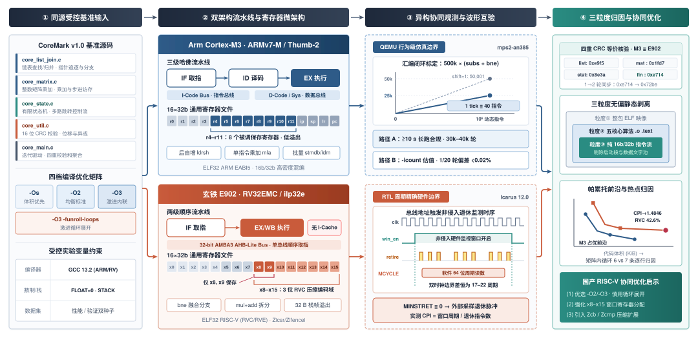
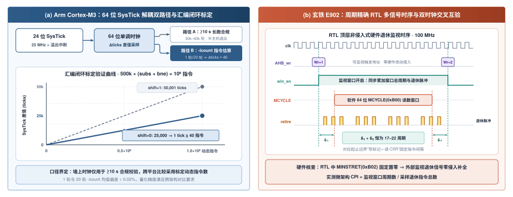
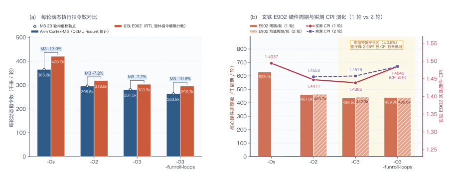
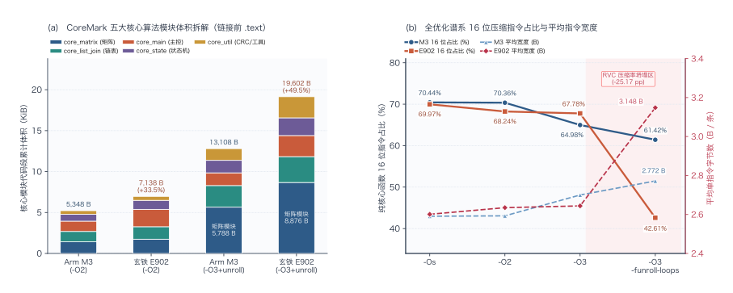
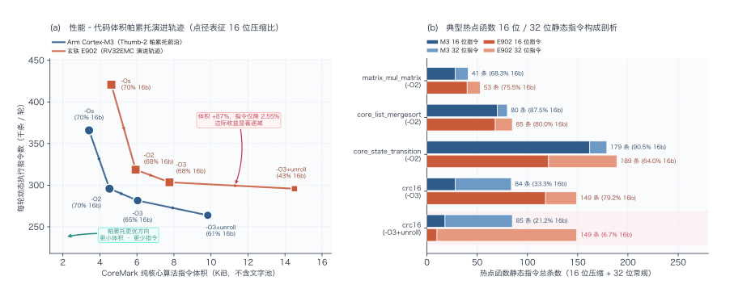

# CoreMark 在 Arm Cortex-M3 与玄铁 E902 (RISC-V) 上的比较研究

> 面向 32 位嵌入式微控制器典型商业架构（**Arm Cortex-M3 / ARMv7-M Thumb-2**）与国产开源精简架构（**玄铁 E902 / RV32EMC ilp32e**）的受控交叉编译、异构协同仿真观测、三粒度静态代码密度剖析与微架构归因研究。

- **核心技术文档**：
  - [完整工程实验与技术分析报告（REPORT.md）](REPORT.md)
  - [软硬件环境与目标码核验原始日志（env_check.log）](benchmark/results/env_check.log)
  - [三粒度 ELF 静态剖析原始数据（elf_analysis.json）](benchmark/results/elf_analysis.json)

---

## 一、研究概览与系统架构

本项目以国际公认的 **EEMBC CoreMark v1.0**（链表查找/归并、整数矩阵乘加、有限状态机、16 位 CRC 校验）为统一负载，在**未修改一行核心算法源码**、**同代 GCC 13.2 编译器**、**纯整数栈内存配置**的严格受控条件下，覆盖 `-Os`、`-O2`、`-O3`、`-O3 -funroll-loops` 四档优化及“性能 / 验证”双数据种子，系统对比 Arm Cortex-M3 与玄铁 E902 的指令集表达力、编译优化边界与微架构效率。



---

## 二、软硬件实验环境

### 2.1 硬件宿主机与容器化隔离底座

为确保实验完全可复现并屏蔽宿主机系统差异（玄铁官方辅助转换工具 `Srec2vmem` 为 Linux x86-64 静态可执行文件），全部编译、仿真与二进制解析均在基于 [Dockerfile](Dockerfile) 构建的隔离 Docker 容器中完成：

| 层级 | 配置项 | 实测参数（详见 [env_check.log](benchmark/results/env_check.log)） |
| :--- | :--- | :--- |
| **物理宿主机** | 服务器型号 | Dell PowerEdge R7525（裸金属物理机，`systemd-detect-virt: none`） |
| | 处理器 | 2 × AMD EPYC 7763 64-Core Processor（共 256 逻辑核，x86_64，AMD-V） |
| | 宿主操作系统 | CentOS Linux 7.9.2009（Linux `3.10.0-1160.119.1.el7.x86_64`） |
| **容器运行时** | Docker 版本 | Docker `29.8.1`（`linux/amd64` 镜像） |
| **实验容器 OS** | 基础镜像 | **Ubuntu 24.04.5 LTS (Noble Numbat)** |
| **跨平台复现** | 本地复现兼容性 | 支持 Linux x86-64、macOS（Apple Silicon / Intel）及 Windows WSL2 通过 `--platform linux/amd64` 一键构建运行 |

### 2.2 双平台软件工具链与仿真验证环境

| 对比维度 | Arm Cortex-M3 平台 | 玄铁 E902 (RISC-V) 平台 |
| :--- | :--- | :--- |
| **指令集与 ABI** | ARMv7-M Thumb-2（`-mcpu=cortex-m3 -mthumb`，EABI5 软浮点） | RV32EMC（`-march=rv32emc_zicsr_zifencei -mabi=ilp32e`） |
| **目标处理器微架构** | 三级哈佛流水线（独立 I-Code / D-Code / Sys 总线）；16×32 位寄存器，含 **8 个** `callee-saved`（`r4–r11`） | 两级顺序流水线（单 32 位 AMBA3 AHB-Lite 总线，无 I-Cache）；16×32 位寄存器，`ilp32e` 仅 **2 个** `callee-saved`（`x8, x9`），3 位 RVC 压缩编码域 `x8–x15` |
| **交叉编译器** | `arm-none-eabi-gcc` **13.2.1**（`15:13.2.rel1-2`） | `riscv64-unknown-elf-gcc` **13.2.0**（`13.2.0-11ubuntu1+12`） |
| **二进制工具集** | `binutils-arm-none-eabi` + `libnewlib-arm-none-eabi` | `binutils-riscv64-unknown-elf` + `Srec2vmem` |
| **执行与仿真器** | **QEMU 8.2.2**（`qemu-system-arm -M mps2-an385`，AArch32 Semihosting 退出） | **Icarus Verilog 12.0**（`iverilog` / `vvp`）+ 玄铁 E902 开源 RTL 硬件源码 |
| **基准与控制变量** | CoreMark v1.0；`HAS_FLOAT=0`、`MEM_METHOD=MEM_STACK`、`-ffunction-sections -fdata-sections -Wl,--gc-sections` | 同左（完全共享 [benchmark/common/coremark](benchmark/common/coremark) 源码与编译宏定义） |
| **编译优化矩阵** | `-Os`、`-O2`、`-O3`、`-O3 -funroll-loops` | `-Os`、`-O2`、`-O3`、`-O3 -funroll-loops` |
| **计时与指令计量** | 25 MHz 24 位 SysTick 扩展 64 位单调时钟：常规 ≥10 s 长跑校验 + 汇编闭环标定 `-icount shift=0` | 内部 64 位硬件周期计数器 `MCYCLE (0xB00)` + 顶层非侵入式 RTL 退休监视模块 [retire_mon.v](benchmark/e902/retire_mon.v) |
| **分析与制图工具** | Python 3、`analyze_elf.py`、`matplotlib`（纯矢量 SVG 输出） | 同左 |

### 2.3 源码一致性与目标映像有效性核验

以下核验均留存于 [benchmark/results/env_check.log](benchmark/results/env_check.log)：

- **上游源码锁定**：
  - EEMBC CoreMark 上游镜像 commit：`1f483d5b8316753a742cbf5590caf5bd0a4e4777`（`core_list_join.c`、`core_main.c`、`core_matrix.c`、`core_state.c`、`core_util.c` 全部通过上游 `coremark.md5` 与 SHA-256 校验，零修改）。
  - 玄铁 E902 开源 RTL 上游镜像 commit：`964602775d7d8bf10607a11b767a306dffc2488f`。
- **目标可执行文件头核验（`readelf -h`）**：
  - `coremark_m3.elf`：`ELF32` · `Machine: ARM` · `Flags: 0x5000200 (Version5 EABI, soft-float ABI)`
  - `coremark_e902.elf`：`ELF32` · `Machine: RISC-V` · `Flags: 0x9 (RVC, RVE, soft-float ABI)`

---

## 三、核心观测机制与底层工程适配



### 3.1 Arm Cortex-M3 解耦双路径与 `-icount` 汇编闭环标定
- **路径 A（合规长跑校验）**：常规模式下基于 25 MHz SysTick 扩展 64 位单调时钟，自动迭代探测运行 **12.93–15.62 s**（30,000–40,000 轮），严格通过 EEMBC `≥10 s` 规则与 `Correct operation validated` 验证。
- **路径 B（动态指令标定估算）**：编写受控汇编微基准 [calib_icount.c](benchmark/m3/calib_icount.c)（`500,000 × (subs + bne) = 1,000,000` 条动态指令），在 `-icount shift=0` 下实测得 `25,000` ticks（`shift=1` 得 `50,001` ticks），闭环验证 **`1 SysTick tick ≡ 40 条动态指令`**，1 轮与 20 轮均值偏差 `< 0.02%`。

### 3.2 玄铁 E902 底层适配与非侵入式 RTL 退休监测
在保持 E902 处理器内核微架构零改动的前提下，完成了三项工具链/仿真适配与一项非侵入硬件监视扩展：
1. **ISA 规范适配**：编译选项显式声明 `zicsr_zifencei`，并将 [opene902/smart_run/tests/lib/crt0.s](opene902/smart_run/tests/lib/crt0.s) 中新版 GCC 不识别的 `csrw mtvt, x3` 改写为等价硬件编码 `csrw 0x307, x3`。
2. **数据段装载与时钟使能完善**：在 [benchmark/e902/linker.lcf](benchmark/e902/linker.lcf) 完整保留 `.data` / `.sdata` 加载内容；在 [opene902/smart_run/logical/common/cpu_sub_system_ahb.v](opene902/smart_run/logical/common/cpu_sub_system_ahb.v) 补全 `openE902` 顶层 `.clk_en (clk_en)` 端口连接，避免 Icarus Verilog 端口悬空锁死。
3. **非侵入式硬件退休监视（破解 `MINSTRET ≡ 0` 盲区）**：E902 精简 RTL 将 `MINSTRET (0xB02)` 固定置零；我们在仿真顶层挂载 [retire_mon.v](benchmark/e902/retire_mon.v)，以特定总线写地址作为监视窗开关，同步采样窗口时钟周期与内核退休脉冲，并与内部 64 位 `MCYCLE` 交叉互验——两者边界差恒为 **17–22 个周期**（精确对应起止边界“写标记—读 CSR”固定指令间隔），从而导出真实硬件 CPI。

### 3.3 三粒度静态剥离与科学可比边界
- **三粒度静态代码密度分析（[analyze_elf.py](benchmark/analyze_elf.py)）**：`整包 ELF 映像` → `链接前五核心算法 .o .text` → `反汇编剔除数据文字池后的纯 16/32 位指令流`，彻底隔离启动向量表与常量文字池布局差异。
- **严谨可比边界**：**绝不将 QEMU 行为级墙上运行时间与玄铁 E902 周期精确 RTL 硬件周期直接折算跨核速度比**；跨平台严格限定于架构无关的动态执行指令数与静态指令密度，真实硬件周期与 CPI 仅在玄铁 E902 周期精确 RTL 内部作纵向比较。

---

## 四、核心实验结果与微架构发现

### 4.1 全优化谱系定量对比汇总（CoreMark v1.0，性能种子，纯整数配置）

| 编译优化等级 | M3 估计动态指令/轮 | E902 退休指令/轮 | M3 vs E902 动态指令 | E902 周期/轮 (1 轮 / 2 轮) | E902 实测 CPI (1 轮 / 2 轮) | 纯核心指令字节 & 16 位占比 (M3 vs E902) | E902 平均指令宽 |
| :--- | :---: | :---: | :---: | :---: | :---: | :---: | :---: |
| **`-Os`** | ≈ 365,840 | 420,714 | **-13.04%** | 628,383 / — | 1.4937 / — | 3,498 B (`70.44%`) vs 4,728 B (`69.97%`) | 2.601 B |
| **`-O2`** | ≈ 295,760 | 318,606 | **-7.17%** | 461,045 / 463,694 | 1.4471 / 1.4553 | 4,628 B (`70.36%`) vs 6,074 B (`68.24%`) | 2.635 B |
| **`-O3`** | ≈ 281,520 | 303,457 | **-7.23%** | 436,516 / 442,326 | 1.4385 / 1.4576 | 6,184 B (`64.98%`) vs 7,944 B (`67.78%`) | 2.644 B |
| **`-O3 -funroll-loops`** | ≈ 263,800 | 295,724 | **-10.80%** | 439,008 / 439,015 | **1.4846 / 1.4846** | 10,064 B (`61.42%`) vs 14,858 B (**`42.61%`**) | **3.148 B** |

- **四重 CRC 100% 逐位一致**：
  - 性能种子（`PERFORMANCE_RUN`）：`seedcrc = 0xe9f5`、`crclist = 0xe714`、`crcmatrix = 0x1fd7`、`crcstate = 0x8e3a`（1 轮 `crcfinal = 0xe714`，2 轮 `crcfinal = 0x72be`）。
  - 验证种子（`VALIDATION_RUN`）：`seedcrc = 0x18f2`、`crclist = 0xe3c1`、`crcmatrix = 0x0747`、`crcstate = 0x8d84`。







### 4.2 关键微架构归因结论
1. **指令表达密度优势**：四档优化下 Cortex-M3 动态指令少 `7.17%–13.04%`，核心纯静态指令少 `22.56%–25.74%`。在 `-O2` 矩阵乘法核心内循环中，M3 凭借后自增加载（`ldrsh.w [r3], #2`）与单指令乘加（`mla`）仅需 **6 条指令**；E902 虽通过 `bne` 融合比较与跳转，内循环仍需 **7 条指令**，且因 `ilp32e` 仅有 `x8, x9` 两个保存寄存器而外层循环溢出更频繁。
2. **RV32EMC 激进展开下的“压缩率坍塌”**：常规优化（`-Os / -O2 / -O3`）下 E902 的 16 位 RVC 压缩占比达 `67.78%–69.97%`（逼近 Thumb-2）；但在 `-O3 -funroll-loops` 下，因常用 16 位 RVC 指令受限于 3 位寄存器索引（仅编码 `x8–x15`）及窄偏移，大量指令退化为 32 位常规指令，16 位占比骤降至 **`42.61%`**（其中热点 `crc16` 由 `79.19%` 骤降至 `6.71%`），五核心模块体积由 `7,138 B`（`-O2`）膨胀至 `19,602 B`。
3. **无 I-Cache 两级流水线的 CPI 逆向抬升**：`-O3` 到 `-O3 -funroll-loops` 虽减少 2.55% 动态指令，但平均单指令宽度从 `2.644 B` 扩至 `3.148 B`，加剧单 32 位 AHB-Lite 总线的跨字边界取指压力，使 E902 实测 CPI 稳定抬升至 **`1.4846`**，整体周期落于 `±0.8%` 平台区，几乎完全抵消循环展开收益。

---

## 五、一键构建、复现与快速演示

### 5.1 构建并进入 Docker 实验容器

```bash
git clone https://github.com/shaohuahuawww/ARM-and-RISCV.git
cd ARM-and-RISCV

# 构建 Ubuntu 24.04 交叉编译与仿真容器（跨平台统一 linux/amd64）
docker build --platform linux/amd64 -t coremark-m3-e902:ubuntu24 .

# 挂载项目目录并进入容器
docker run --rm -it --platform linux/amd64 -v "$PWD:/work" -w /work coremark-m3-e902:ubuntu24 bash
```

### 5.2 环境版本自检（容器内）

```bash
arm-none-eabi-gcc --version | head -n 1
riscv64-unknown-elf-gcc --version | head -n 1
qemu-system-arm --version | head -n 1
iverilog -V | head -n 1
```

### 5.3 核心实验复现与演示命令（容器内）

```bash
# 1. Arm Cortex-M3 汇编微基准标定（约 1 秒，输出 25,000 ticks -> 1 tick = 40 insns）
make -C benchmark/m3 run-calib

# 2. Arm Cortex-M3 标准 >=10 s 合规性能运行（约 13 秒，验证 Correct operation validated）
make -C benchmark/m3 run OPT=-O2 ITERATIONS=0 TAG=demo_m3_long

# 3. Arm Cortex-M3 -icount shift=0 单轮动态指令估算
make -C benchmark/m3 all OPT=-O2 ITERATIONS=1 TAG=demo_m3_ic1
qemu-system-arm -M mps2-an385 -nographic -icount shift=0 \
  -semihosting-config enable=on,target=native \
  -kernel benchmark/m3/build_demo_m3_ic1/coremark_m3.elf

# 4. 玄铁 E902 周期精确 RTL 仿真（-O2 单轮，耗时约 7 分钟，输出 [E902-MON] cycles/instret 与 MCYCLE）
make -C benchmark/e902 run OPT=-O2 ITERATIONS=1 TAG=demo_e902_it1

# 5. 三粒度 ELF 静态体积与 16/32 位编码混合比自动化剖析
python3 benchmark/analyze_elf.py
```

### 5.4 重新生成纯矢量 SVG 图表（Python 3 + matplotlib）

```bash
# 生成技术路线、时间窗时序与基线对比 SVG（proposal/figures/）
python3 proposal/generate_figures.py

# 生成全景架构、动态指令/CPI、代码密度与帕累托热点 SVG（midterm/figures/）
python3 midterm/generate_figures.py
```

---

## 六、仓库目录结构

```text
ARM-and-RISCV/
├── Dockerfile                        # Ubuntu 24.04 双工具链 + QEMU + Icarus Verilog 容器定义
├── README.md                         # 项目总览、软硬件环境、实验结果与复现指南
├── REPORT.md                         # 完整工程实验记录与深度分析报告
├── benchmark/
│   ├── analyze_elf.py                # 三粒度 ELF 节区、核心模块体积与 16/32 位编码自动统计脚本
│   ├── common/coremark/              # 双平台共享 CoreMark v1.0 核心源码（零修改，MD5 锁定）
│   ├── m3/                           # Arm Cortex-M3 裸机移植（startup.c / core_portme.c / calib_icount.c / Makefile）
│   ├── e902/                         # 玄铁 E902 裸机移植与非侵入硬件监视（retire_mon.v / linker.lcf / Makefile）
│   └── results/                      # 全量实测日志、env_check.log 环境核验记录与 elf_analysis.json
├── coremark/                         # 上游 EEMBC CoreMark v1.0 参考源码（commit 1f483d5）
├── opene902/                         # 上游玄铁 E902 开源 RTL（commit 9646027，含 .clk_en 与 crt0.s 适配）
├── proposal/                         # 技术路线与时序对照纯矢量 SVG 图表及生成脚本
└── midterm/                          # 全景架构、性能/CPI、代码密度与帕累托纯矢量 SVG 图表及生成脚本
```
