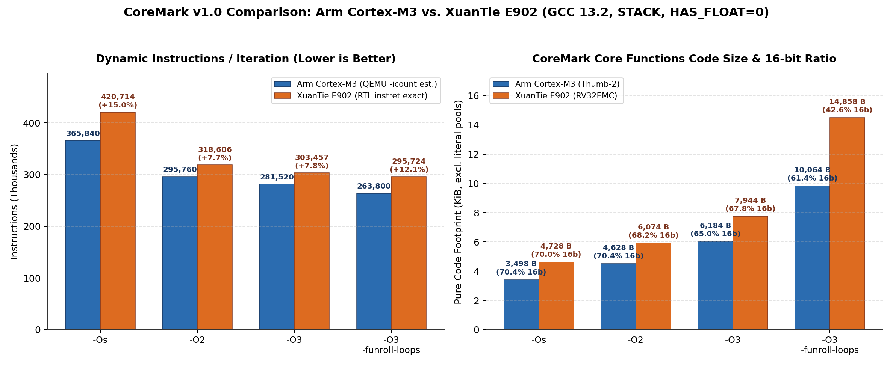

# CoreMark 在 Arm Cortex-M3 与玄铁 E902 (RISC-V RV32EMC) 上的移植、仿真与对比分析报告

## 1. 项目背景与目标

本项目完成了课程题目 **《CoreMark 在 Arm Cortex-M3 和玄铁 E902 RISCV 的比较》** 的全流程工程实现与研究分析：搭建 Arm Cortex-M3 与玄铁 E902 两套交叉编译器及对应仿真平台，基于同一份官方 **EEMBC CoreMark v1.0** 源码分别编译生成可执行文件并实际运行，围绕动态指令数、周期性能（E902 RTL 实测）、代码密度、16/32 位指令占比及微架构成因开展系统对比。

为保证公平对比与结果可复现，两组目标均严格控制变量：
- **同一份核心源码**：共同编译 [benchmark/common/coremark](benchmark/common/coremark) 中完全未修改的 CoreMark v1.0 源码（`core_main.c`、`core_list_join.c`、`core_matrix.c`、`core_state.c`、`core_util.c`、`coremark.h`、`cvt.c`）。对照上游 [coremark/coremark.md5](coremark/coremark.md5)，5 个 `.c` 核心文件 MD5 全部校验通过（`OK`）；`coremark.h`（SHA-256 `42642b9a06c7ed2b3bd9eda971b7c3868c4f5d27bf7ef6c4bba11291a0c2598a`）与当前克隆的上游仓库（commit `1f483d5b8316753a742cbf5590caf5bd0a4e4777`）[coremark/coremark.h](coremark/coremark.h) 字节完全一致。
- **同一代 GCC 与统一测试参数**：均采用 GCC 13.2.x；统一设置 `HAS_FLOAT=0`（纯整数测试）、`MEM_METHOD=MEM_STACK`（栈内存分配），完整覆盖 `-Os`、`-O2`、`-O3`、`-O3 -funroll-loops` 四档优化及 `PERFORMANCE_RUN`、`-O2` `VALIDATION_RUN` 两套数据种子。

---

## 2. 实验环境与移植工程架构

### 2.1 运行环境、交叉编译器与目标文件核验

全部编译与仿真在远程物理服务器（Dell PowerEdge R7525，CentOS Linux 7.9.2009，`systemd-detect-virt: none`）构建的隔离 **Ubuntu 24.04.5 LTS** Docker 容器（镜像定义见 [Dockerfile](Dockerfile)）内运行，完整版本与目标文件头检验见 [benchmark/results/env_check.log](benchmark/results/env_check.log)：

| 组件 | Arm Cortex-M3 平台 | 玄铁 E902 (RISC-V) 平台 |
| :--- | :--- | :--- |
| 指令集与 ABI | ARMv7-M (`-mcpu=cortex-m3 -mthumb`) | RV32EMC (`-march=rv32emc_zicsr_zifencei -mabi=ilp32e`) |
| 通用寄存器预算 | 16 个 32 位寄存器（含 `sp/lr/pc`，`r4–r11` 等可作 callee-saved） | 16 个 32 位寄存器 `x0–x15`（`ilp32e` 中仅 `x8, x9` 两个 callee-saved） |
| 交叉编译器 | `arm-none-eabi-gcc (15:13.2.rel1-2) 13.2.1 20231009` | `riscv64-unknown-elf-gcc (13.2.0-11ubuntu1+12) 13.2.0` |
| ELF 文件头实测 (`readelf -h`) | 32-bit `ELF32`, `ET_EXEC`, `Machine: ARM`, `Version5 EABI, soft-float` | 32-bit `ELF32`, `ET_EXEC`, `Machine: RISC-V`, `Flags: RVC, RVE, soft-float` |
| 仿真执行平台 | `qemu-system-arm 8.2.2`（`mps2-an385` 模型） | `Icarus Verilog 12.0` + 官方 `openE902` RTL（commit `96460277...`） |
| 计时与指令统计方式 | SysTick（25 MHz）+ 标定 `-icount shift=0` 动态指令估计 | 硬件 64 位 `MCYCLE (0xB00)` + Verilog [retire_mon.v](benchmark/e902/retire_mon.v) 无侵入计数 |
| 工程目录 | [benchmark/m3](benchmark/m3) | [benchmark/e902](benchmark/e902) |

> **环境与演示说明**：[Dockerfile](Dockerfile) 内所有软件包安装与编译命令可直接运行于任何标准 Ubuntu 24.04 x86-64 虚拟机或容器内；因 `opene902` 配套工具 [Srec2vmem](opene902/smart_run/tests/bin/Srec2vmem) 为静态链接的 Linux x86-64 可执行文件，建议按根目录 [README.md](README.md) 中的容器命令一键启动演示。两个工程的 `Makefile` 均已去除路径硬编码并加入 `.cflags` 标记检查，更换优化选项、种子或迭代次数不会误复用旧 `.o` 文件。

### 2.2 移植与官方开源库关键 Bug 修复记录

1. **玄铁 `openE902` RTL `clk_en` 悬空锁死修复**（[cpu_sub_system_ahb.v](opene902/smart_run/logical/common/cpu_sub_system_ahb.v)）：原始仓库例化 `openE902 x_e902` 时遗漏 `.clk_en(clk_en)` 端口，导致 Icarus Verilog 仿真中 `clk_en` 为 `z`、内核停留在 `RESET` 状态。补全连接后恢复正常取指执行。
2. **GCC 13.2 RISC-V CSR 兼容性修复**（[crt0.s](opene902/smart_run/tests/lib/crt0.s) 与 [benchmark/e902/Makefile](benchmark/e902/Makefile)）：显式使用 `-march=rv32emc_zicsr_zifencei`，将 `crt0.s` 中 GCC 13.2 拒绝的 `csrw mtvt, x3` 替换为 `csrw 0x307, x3`，并为 `Srec2vmem` 赋予可执行权限。
3. **玄铁 E902 `.data`/`.sdata` 启动加载缺失修复**（[benchmark/e902/Makefile](benchmark/e902/Makefile) 与 [linker.lcf](benchmark/e902/linker.lcf)）：在生成 `inst.pat` 的 `objcopy` 中显式包含 `-j .data* -j .sdata* -j .eh_frame*`，确保 `crt0.s` 从 `__erodata` 复制初值时不会将 `seed4_volatile` 清零而误入 1 亿次自动循环，同时完善 `*crt0.o` 与 `.bss`/`.sbss`/`.COMMON` 段放置。
4. **玄铁 E902 退休指令监控模块**（[retire_mon.v](benchmark/e902/retire_mon.v) 与 [core_portme.c](benchmark/e902/core_portme.c)）：经核查 `openE902` RTL 源码，硬件 `MCYCLE (0xB00)` 为真实 64 位计数器，而 `MINSTRET (0xB02)` 接死为 `32'b0`。因此由程序向监视地址 `0x6000fff4` 写入窗口启停信号 `1`/`2`，在 testbench 中直接观测 `biu_pad_retire` 获取精确周期数与退休指令数，并开启 `-DNO_DUMP -DNO_MONITOR` 屏蔽数百 MB 的 `GPR.log` 冗余文件。
5. **Arm Cortex-M3 QEMU 启动与 `-icount` 精确标定**（[startup.c](benchmark/m3/startup.c)、[calib_icount.c](benchmark/m3/calib_icount.c)）：`qemu-system-arm -M mps2-an385` 不重复传 `-cpu cortex-m3` 即可正常启动，通过 AArch32 semihosting `SYS_EXIT (0x18)`（`r1=0x20026`）返回退出码 `0`。编写独立标定程序 [calib_icount.c](benchmark/m3/calib_icount.c)（执行 500,000 次 `subs + bne` = 1,000,000 条指令），在 25 MHz SysTick 下实测（[icount_calibration.log](benchmark/results/m3/icount_calibration.log)）：
   - `-icount shift=0`：`CAL_DT = 25000` ticks → 精确标定为 **1 SysTick tick = 40 条动态指令**；
   - `-icount shift=1`：`CAL_DT = 50001` ticks → 精确标定为 1 SysTick tick ≈ 20 条动态指令（含首尾读取误差 1 tick）。

---

## 3. 实验结果汇总与正确性校验

### 3.1 测试正确性与 CRC 校验一致性

在所测 `PERFORMANCE_RUN`（`-Os`、`-O2`、`-O3`、`-O3 -funroll-loops`）以及 `VALIDATION_RUN`（仅 `-O2` 覆盖校验）的种子与迭代配置下，**Arm Cortex-M3 与玄铁 E902 输出的四项核心数据校验码完全一致**：
- **性能种子（`PERFORMANCE_RUN=1`）**：`seedcrc = 0xe9f5`、`[0]crclist = 0xe714`、`[0]crcmatrix = 0x1fd7`、`[0]crcstate = 0x8e3a`；1 轮 `crcfinal = 0xe714`，2 轮 `crcfinal = 0x72be`。
- **验证种子（`VALIDATION_RUN=1`，`-O2`）**：`seedcrc = 0x18f2`、`[0]crclist = 0xe3c1`、`[0]crcmatrix = 0x0747`、`[0]crcstate = 0x8d84`；1 轮 `crcfinal = 0xe3c1`（M3 40,000 轮长跑为 `0xbe81`）。

### 3.2 玄铁 E902 RTL 周期精确仿真结果（Cycle-Accurate）

以下数据来自官方 `openE902` RTL 在 `iverilog`/`vvp` 中的硬件级仿真（完整日志见 [benchmark/results/e902](benchmark/results/e902)）：

| 测试用例 (`TAG`) | 优化参数 & 模式 | 迭代次数 | `mcycle` (`Total ticks`) | 均值周期/轮 (`cycles/iter`) | 监视窗口周期 (`cycles`) | 退休指令数 `instret` (均值/轮) | 实测 `CPI` | 每百万周期折算迭代数 (`10⁶/cycles`, RTL 短跑) | 校验码 (`seed / list / matrix / state / final`) |
| :--- | :--- | :---: | :---: | :---: | :---: | :---: | :---: | :---: | :--- |
| [Os_it1](benchmark/results/e902/Os_it1.log) | `-Os` `PERF` | 1 | 628,383 | 628,383 | 628,405 | 420,714 (420,714) | 1.4937 | **1.5913** | `e9f5 / e714 / 1fd7 / 8e3a / e714` |
| [O2_it1](benchmark/results/e902/O2_it1.log) | `-O2` `PERF` | 1 | 461,045 | 461,045 | 461,063 | 318,606 (318,606) | 1.4471 | **2.1689** | `e9f5 / e714 / 1fd7 / 8e3a / e714` |
| [O2_it2](benchmark/results/e902/O2_it2.log) | `-O2` `PERF` | 2 | 927,388 | 463,694 | 927,406 | 637,248 (318,624) | 1.4553 | **2.1565** | `e9f5 / e714 / 1fd7 / 8e3a / 72be` |
| [O3_it1](benchmark/results/e902/O3_it1.log) | `-O3` `PERF` | 1 | **436,516** | **436,516** | 436,534 | 303,457 (303,457) | **1.4385** | **2.2908** | `e9f5 / e714 / 1fd7 / 8e3a / e714` |
| [O3_it2](benchmark/results/e902/O3_it2.log) | `-O3` `PERF` | 2 | 884,652 | 442,326 | 884,670 | 606,922 (303,461) | 1.4576 | **2.2607** | `e9f5 / e714 / 1fd7 / 8e3a / 72be` |
| [O3_unroll_it1](benchmark/results/e902/O3_unroll_it1.log) | `-O3 -funroll-loops` `PERF` | 1 | 439,008 | 439,008 | 439,025 | **295,724** (295,724) | 1.4846 | **2.2778** | `e9f5 / e714 / 1fd7 / 8e3a / e714` |
| [O3_unroll_it2](benchmark/results/e902/O3_unroll_it2.log) | `-O3 -funroll-loops` `PERF` | 2 | 878,030 | 439,015 | 878,047 | **591,456** (295,728) | 1.4846 | **2.2778** | `e9f5 / e714 / 1fd7 / 8e3a / 72be` |
| [O2_val_it1](benchmark/results/e902/O2_val_it1.log) | `-O2` `VALIDATION` | 1 | 468,903 | 468,903 | 468,921 | 319,059 (319,059) | 1.4697 | **2.1326** | `18f2 / e3c1 / 0747 / 8d84 / e3c1` |

> **口径与交叉校验注记**：
> 1. 监视窗口周期比软件 `mcycle` 读数固定多 **17–22 个周期**（例如 `O2_it1` 中 461,063 vs 461,045 差 18 周期），源于 `start_time()` 先写开始标记再读 CSR、`stop_time()` 先读 CSR 再写结束标记的指令间隔，两路独立计时高度自洽。
> 2. 在 testbench 默认 100 MHz 时钟下，1 轮与 2 轮仿真运行物理时长约 **4.37–9.27 ms**，未达到 CoreMark 官方 10 秒时长门槛，因此日志中出现 `ERROR! Must execute for at least 10 secs...` 与 `Errors detected`；这与 CRC 正确、仿真 `simulation finished successfully` 完全相容。表中指标为基于 RTL 精确硬件周期的**短跑折算值**（移植代码以定点截断保留 4 位小数输出，如 `10⁶/436516 ≈ 2.2908`），并非满足官方 10 秒规则的认证分数。

### 3.3 Arm Cortex-M3 QEMU 功能验证（≥10 秒）与动态指令数估计

以下数据来自 QEMU `mps2-an385` 标准长跑日志与标定 `-icount shift=0` 日志（目录：[benchmark/results/m3](benchmark/results/m3)）：

| 编译优化等级 | ≥10 秒长跑日志（均打印 `Correct operation validated`） | QEMU `-icount shift=0` 动态指令数估计/轮 (1 轮实测, `ticks×40`) | 20 轮 `-icount` 总 ticks / 约均值指令数/轮 |
| :--- | :--- | :---: | :---: |
| **`-Os`** | [Os_10s.log](benchmark/results/m3/Os_10s.log)：30,000 次 / 373,756,058 ticks（14.95s 取整 14s，整数输出 2142 次/s） | ≈ **365,840**（9,146 ticks，[Os_ic1.log](benchmark/results/m3/Os_ic1.log)） | 182,924 / ≈ **365,848.0**（[icount_suite.log](benchmark/results/m3/icount_suite.log)） |
| **`-O2`** | [O2_10s.log](benchmark/results/m3/O2_10s.log)：40,000 次 / 324,082,692 ticks（12.96s 取整 12s，整数输出 3333 次/s） | ≈ **295,760**（7,394 ticks，[O2_ic1.log](benchmark/results/m3/O2_ic1.log)） | 147,880 / ≈ **295,760.0**（2 轮 [O2_ic2.log](benchmark/results/m3/O2_ic2.log) 14,788 ticks） |
| **`-O3`** | [O3_10s.log](benchmark/results/m3/O3_10s.log)：40,000 次 / 390,409,441 ticks（15.62s 取整 15s，整数输出 2666 次/s） | ≈ **281,520**（7,038 ticks，[O3_ic1.log](benchmark/results/m3/O3_ic1.log)） | 140,741 / ≈ **281,482.0**（[icount_suite.log](benchmark/results/m3/icount_suite.log)） |
| **`-O3 -funroll-loops`** | [O3_unroll_10s.log](benchmark/results/m3/O3_unroll_10s.log)：40,000 次 / 326,646,970 ticks（13.07s 取整 13s，整数输出 3076 次/s） | ≈ **263,800**（6,595 ticks，[O3_unroll_ic1.log](benchmark/results/m3/O3_unroll_ic1.log)） | 131,906 / ≈ **263,812.0**（[icount_suite.log](benchmark/results/m3/icount_suite.log)） |
| **`-O2` (`VALIDATION`)** | [O2_val_10s.log](benchmark/results/m3/O2_val_10s.log)：40,000 次 / 323,327,231 ticks（12.93s 取整 12s，整数输出 3333 次/s） | ≈ **295,760**（7,394 ticks，[O2_val_ic1.log](benchmark/results/m3/O2_val_ic1.log)） | — |

> **QEMU 计时口径说明**：
> 1. 正常无 `-icount` 模式下，QEMU 的 `Iterations/Sec` 反映**宿主机实时墙上时钟与 JIT 调度速度**，且 CoreMark 默认打印使用整数截断（如 `O2_10s.log` 中 `324,082,692 / 25e6 = 12.9633 s` 截断为 `12 s`，故 `40000 / 12 = 3333`，按原始 ticks 精确复算为 `3085.6` 次/秒）。该吞吐量仅证明 ≥10 秒长跑合法通过，**不可用于比较 Cortex-M3 与玄铁 E902 的真实硬件主频性能**。
> 2. 启用 `-icount shift=0` 后，QEMU 按客户机指令数推进虚拟时钟（1 tick 粒度 = 40 条指令），带有起止采样边界及 `SysTick` 读取开销，因此 20 轮均值与单轮估值存在几十条指令的量化微差（如 `-O3` 单轮 281,520 vs 20 轮均值 281,482），但已足以准确反映跨优化等级的指令数量级规律。

---

## 4. Arm Cortex-M3 与玄铁 E902 核心指标深度对比



### 4.1 相同工作负载下的动态指令数对比（1 轮）

在两个平台分别用 **QEMU `-icount` 估计执行指令数** 与 **RTL `biu_pad_retire` 精确退休指令数** 进行对比，可在同一任务负载下客观衡量指令集的动态表达效率：

| 优化等级 | M3 QEMU `-icount` 动态指令估计/轮 (约) | E902 RTL 退休指令/轮 | E902 相对 M3 指令数增幅 | M3 相对 E902 指令数降幅 | E902 实测硬件 `CPI` (1 轮 / 2 轮) | E902 短跑折算 (`10⁶/cycles`) |
| :--- | :---: | :---: | :---: | :---: | :---: | :---: |
| **`-Os`** | ≈ 365,840 | 420,714 | **+15.00%** | **-13.04%** | 1.4937 / — | 1.5913 |
| **`-O2`** | ≈ 295,760 | 318,606 | **+7.72%** | **-7.17%** | 1.4471 / 1.4553 | 2.1689 / 2.1565 |
| **`-O3`** | ≈ 281,520 | 303,457 | **+7.79%** | **-7.23%** | **1.4385** / 1.4576 | **2.2908** / 2.2607 |
| **`-O3 -funroll-loops`** | ≈ **263,800** | **295,724** | **+12.10%** | **-10.80%** | 1.4846 / 1.4846 | 2.2778 / **2.2778** |

**核心实验发现**：
1. **指令表达效率差异稳定**：在全部 4 档优化下，Cortex-M3 完成每轮 CoreMark 执行的指令数均比玄铁 E902 少 **7.17%–13.04%**（换言之，E902 需比 M3 多执行 **+7.72%–+15.00%** 的动态指令）。
2. **`-O3` 与 `-O3 -funroll-loops` 在玄铁 E902 上的多轮敏感性验证**：在 1 轮测试中，`-O3` 周期数比 `-O3 -funroll-loops` 少 0.57%（`436,516 vs 439,008`）；补做 2 轮 RTL 对照后，`-O3` 平均每轮周期变为 `442,326`（`CPI=1.4576`），而 `-O3 -funroll-loops` 保持在 `439,015`（`CPI=1.4846`），排名小幅反超 **0.75%**。综合 1 轮与 2 轮实测可知：两者硬件周期差距稳定落于 **±0.8%** 窄区间内；虽然 `-funroll-loops` 确实减少了 **2.55%** 的动态退休指令，但因实测 `CPI` 稳定升至 `1.4846` 而基本抵消了指令减少的收益，远不像在 M3 上带来 `-6.29%` 的指令大幅下降。

### 4.2 静态代码体积、核心模块 `.text` 与 16/32 位指令占比对比

详细 ELF 解析保存在 [elf_analysis.json](benchmark/results/elf_analysis.json)（由 [analyze_elf.py](benchmark/analyze_elf.py) 自动生成）。由于 E902 的 `crt0.o` 含 1 KB 向量表（`text=1408 B`）而 M3 的 `startup.o` 仅 `text=136 B, rodata=93 B`，下表同时给出**链接后整包 ELF `text`**、**链接前 CoreMark 5 个核心 `.o`（`core_main/list_join/matrix/state/util`）纯 `.text` 累加值**，以及**反汇编提取的纯 CoreMark 函数指令统计**（已剔除 `.word`/`.rodata` 数据文字池）：

| 优化等级 | 平台 | 链接后整包 ELF `text` (含 rodata) | 链接前 CoreMark 5 `.o` `.text` 累加 | 核心 `.o` `.text` E902/M3 增幅 | 纯 CoreMark 函数静态指令统计 (`16b + 32b`) | M3 比 E902 指令条数降幅 (E902 增幅) | 16 位指令占比 | 平均单指令字节数 |
| :--- | :--- | :---: | :---: | :---: | :---: | :---: | :---: | :---: |
| **`-Os`** | M3 | 8,404 B | 3,806 B | — | 1,350 条 (`951×16b + 399×32b`, 3,498 B) | **-25.74%** | **70.44%** | **2.591 B** |
| **`-Os`** | E902 | 11,200 B | 5,390 B | **+41.62%** | 1,818 条 (`1272×16b + 546×32b`, 4,728 B) | (+34.67%) | 69.97% | 2.601 B |
| **`-O2`** | M3 | 10,112 B | 5,348 B | — | 1,785 条 (`1256×16b + 529×32b`, 4,628 B) | **-22.56%** | **70.36%** | **2.593 B** |
| **`-O2`** | E902 | 13,368 B | 7,138 B | **+33.47%** | 2,305 条 (`1573×16b + 732×32b`, 6,074 B) | (+29.13%) | 68.24% | 2.635 B |
| **`-O3`** | M3 | 12,304 B | 7,648 B | — | 2,290 条 (`1488×16b + 802×32b`, 6,184 B) | **-23.77%** | 64.98% | 2.700 B |
| **`-O3`** | E902 | 16,244 B | 9,962 B | **+30.26%** | 3,004 条 (`2036×16b + 968×32b`, 7,944 B) | (+31.18%) | **67.78%** | **2.644 B** |
| **`-O3 -funroll-loops`** | M3 | 16,928 B | 13,108 B | — | 3,631 条 (`2230×16b + 1401×32b`, 10,064 B) | **-23.07%** | **61.42%** | **2.772 B** |
| **`-O3 -funroll-loops`** | E902 | 24,736 B | 19,602 B | **+49.54%** | 4,720 条 (`2011×16b + 2709×32b`, 14,858 B) | (+29.99%) | **42.61%** | **3.148 B** |

> 数据段对比：`-O2`/`-O3`/`-Os`（`ITERATIONS>=1`）下，M3 整包 ELF `data=12B, bss=40B`，E902 为 `data=12B, bss=28B`；`-O2` 下核心 5 个 `.o` 只读常数 `.rodata` 分别为 M3 `1,322 B` 与 E902 `1,342 B`，几乎完全相当。分模块 `.o` `.text` 差异主要集中在 `core_main.o`（`-O2`: M3 1,288 B vs E902 2,174 B）与 `-O3 -funroll-loops` 下的 `core_matrix.o`（M3 5,788 B vs E902 **8,876 B**）。

---

## 5. 微架构与指令集深层成因分析

### 5.1 为什么 Thumb-2 静态核心指令少 22.56%–25.74%、动态指令少 7.17%–13.04%？

以 `-O2` 下实际反汇编的热点函数 `matrix_mul_matrix` 为例（见 `build_O2_ic1/coremark_m3.obj` 与 `build_O2_it1/coremark_e902.obj`）：

- **Arm Cortex-M3 (`14d0–14e0`，内层循环 6 条指令)**：
  ```asm
  ldrsh.w fp, [r3], #2    @ 1 条指令：带符号扩展读取 16 位矩阵元素 + 基址自动后自增 +2
  ldrsh.w sl, [r2]        @ 带符号扩展读取另一元素
  cmp     lr, r3          @ 循环边界比较
  mla     r1, fp, sl, r1  @ 1 条指令：单指令乘加 r1 = fp * sl + r1
  add     r2, r4          @ 矩阵 B 列步进
  bne.n   14d0            @ 条件跳转回循环头
  ```
- **玄铁 E902 RV32EMC (`1cfa–1d0c`，内层循环 7 条指令)**：
  ```asm
  lh      x11, 0(x15)     @ 无后自增寻址
  lh      x9, 0(x13)
  addi    x15, x15, 2     @ 需额外 1 条 addi 移动指针
  add     x13, x13, x6
  mul     x11, x11, x9    @ RV32M 无单指令乘加 mla，需拆分为 mul + add
  add     x12, x12, x11
  bne     x10, x15, 1cfa  @ 合并比较与条件跳转
  ```

对比可见两个决定性因素：
1. **单指令复杂度与寻址模式**：RISC-V 的 `bne x10, x15, 1cfa` 虽把“比较 + 分支”合并为 1 条指令（ARM 需 `cmp + bne.n` 两条），但缺少后自增访存（`ldrsh.w [r3], #2`）与单指令乘加（`mla`），令内层循环仍**净多出 1 条指令**；同时 Cortex-M3 外层还可使用 `stmdb`/`ldmia` 单指令批量压栈/出栈 9 个寄存器并顺带返回、`strd`/`ldrd` 双字读写以及内建桶形移位 ALU 指令（`add.w lr, r2, r0, lsl #1`）。
2. **`RV32E` (`ilp32e`) 的 callee-saved 寄存器饥荒**：Cortex-M3 可分配 8 个 callee-saved 寄存器（`r4–r11`）；而 `ilp32e` 在总共 16 个寄存器中保留 `x0–x4` 后仅余 11 个可分配寄存器，其中 **callee-saved 仅有 `x8(s0)`、`x9(s1)` 2 个**。因此在 `matrix_mul_matrix` 这种三层嵌套循环中，GCC 在入口被迫分配 32 字节栈帧，并在中外层循环反复对 `x2` 栈帧执行 `sw`/`lw` 溢出与重载，直接推高了 `-Os`/`-O2` 的动态指令量。

### 5.2 玄铁 E902 在 `-O3 -funroll-loops` 下 16 位指令骤降与 CPI 升高现象

实测观察到一个显著现象：在 `-Os`/`-O2`/`-O3` 下，E902 核心函数的 16 位 RVC 压缩指令比例稳定在 **67.78%–69.97%**，几乎与 Cortex-M3（64.98%–70.44%）持平；但开启 `-O3 -funroll-loops` 后，E902 16 位指令占比断崖跌至 **42.61%**（平均指令宽度升至 **3.148 B**，例如 `crc16` 在相同 149 条指令下从 `118×16b + 31×32b = 360 B` 变成 `10×16b + 139×32b = 576 B`），同时 E902 实测 `CPI` 由 `-O3` 的 `1.4385 / 1.4576` 升至 `1.4846`：
- **已被指令码流直接证实的编译器编码机制**：RV32C 多数常用 16 位访存、算术与短分支压缩指令（如 `c.lw`/`c.sw`、`c.and`/`c.or`/`c.xor`/`c.sub`、`c.beqz`/`c.bnez` 等）受限于 3 位压缩寄存器字段，只能编码 **`x8–x15`** 这 8 个寄存器，且立即数/栈偏移范围狭窄。激进循环展开提高了变量活跃度与偏移量，使 GCC 不得不大量退回 32 位常规编码，造成核心代码体积相对 `-O3` 膨胀 +87%（核心 `.o` `.text` 增至 19,602 B）。
- **可能的微架构成因推断**：结合 `openE902` 无指令 Cache、通过 32 位 AHB-Lite 总线顺序取指的 2 级流水线结构推测，当 32 位指令占比从 32% 跃升至 57%、且循环体大幅拉长时，更频繁的跨 32 位字边界取指与分支目标分布变化可能是导致实测 `CPI` 上升、并几乎吞噬掉 `-2.55%` 指令减少收益的主要原因（精确定位取指等待占比尚需进一步针对 I-AHB 握手信号插桩统计）。

### 5.3 小结与实验口径边界

> **本实验核心结论**：在相同 CoreMark 性能种子与 `-O2` 下，两端单轮 CRC 完全一致。M3 的 QEMU 标定计时窗口估计执行约 **29.58 万**条指令，E902 的 RTL 窗口记录了 **31.86 万**条退休指令（M3 动态指令数少约 **7.17%**，核心函数纯代码体积少约 **22.56%**）；同时测得玄铁 E902 RTL 单轮耗时 **461,045** 个核心周期（`-O3` 最短达 **436,516** 周期，短跑折算 **2.2908**，建议工程中避免在 E902 上盲目使用 `-funroll-loops`）。由于当前实验仅具备 Cortex-M3 的行为级 QEMU 模型，**要精确比较两颗处理器在同等硅片条件下的实际运行速度，还需取得可比的 Arm Cortex-M3 真实硬件开发板或周期精确 RTL 模型的周期数据**。

---

## 6. 代表性原始运行输出摘录（`-O2`）与文件索引

### 6.1 Arm Cortex-M3 标准 ≥10s 摘录（[O2_10s.log](benchmark/results/m3/O2_10s.log)）

```text
2K performance run parameters for coremark.
CoreMark Size    : 666
Total ticks      : 324082692
Total time (secs): 12
Iterations/Sec   : 3333
Iterations       : 40000
Compiler version : GCC13.2.1 20231009
Compiler flags   : -O2 -mcpu=cortex-m3 -mthumb 
Memory location  : STACK
seedcrc          : 0xe9f5
[0]crclist       : 0xe714
[0]crcmatrix     : 0x1fd7
[0]crcstate      : 0x8e3a
[0]crcfinal      : 0x25b5
Correct operation validated. See README.md for run and reporting rules.
[M3-PORT] Total ticks (64b): 0x0000000013511c04 (324082692 low32), SYSCLK_HZ=25000000
```

### 6.2 玄铁 E902 RTL 1 轮仿真摘录（[O2_it1.log](benchmark/results/e902/O2_it1.log)）

```text
[E902-MON] cycles=461063 instret=318606
2K performance run parameters for coremark.
CoreMark Size    : 666
Total ticks      : 461045
Total time (secs): 0
ERROR! Must execute for at least 10 secs for a valid result!
Iterations       : 1
Compiler version : GCC13.2.0
Compiler flags   : -O2 -march=rv32emc -mabi=ilp32e 
Memory location  : STACK
seedcrc          : 0xe9f5
[0]crclist       : 0xe714
[0]crcmatrix     : 0x1fd7
[0]crcstate      : 0x8e3a
[0]crcfinal      : 0xe714
Errors detected
[E902-PORT] Total mcycle: 461045, Cycles/Iter: 461045, CoreMark/MHz: 2.1689

**********************************************
*    simulation finished successfully        *
**********************************************
../logical/tb/tb.v:204: $finish called at 49900850 (100ps)
```

### 6.3 关键文件索引

- 根目录复现指南：[README.md](README.md) · 容器定义：[Dockerfile](Dockerfile)
- 公共源码与移植工程：[benchmark/common/coremark](benchmark/common/coremark) · [benchmark/m3](benchmark/m3) · [benchmark/e902](benchmark/e902)
- 全量原始日志与统计数据：[env_check.log](benchmark/results/env_check.log) · [icount_calibration.log](benchmark/results/m3/icount_calibration.log) · [elf_analysis.json](benchmark/results/elf_analysis.json) · [benchmark/results/m3](benchmark/results/m3) · [benchmark/results/e902](benchmark/results/e902) · [coremark_comparison.png](benchmark/results/coremark_comparison.png)
